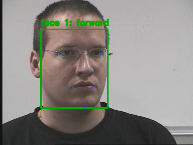
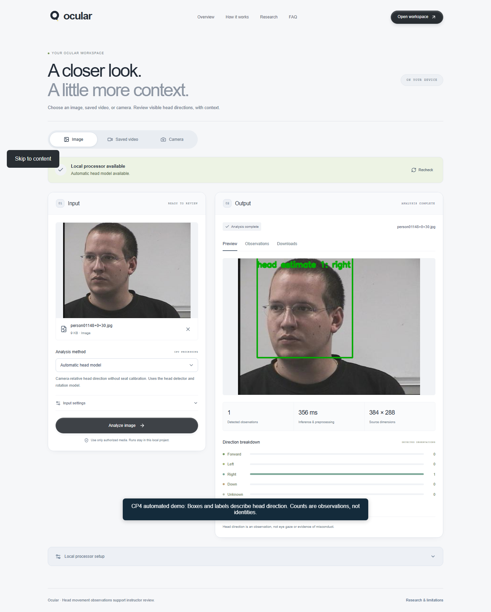
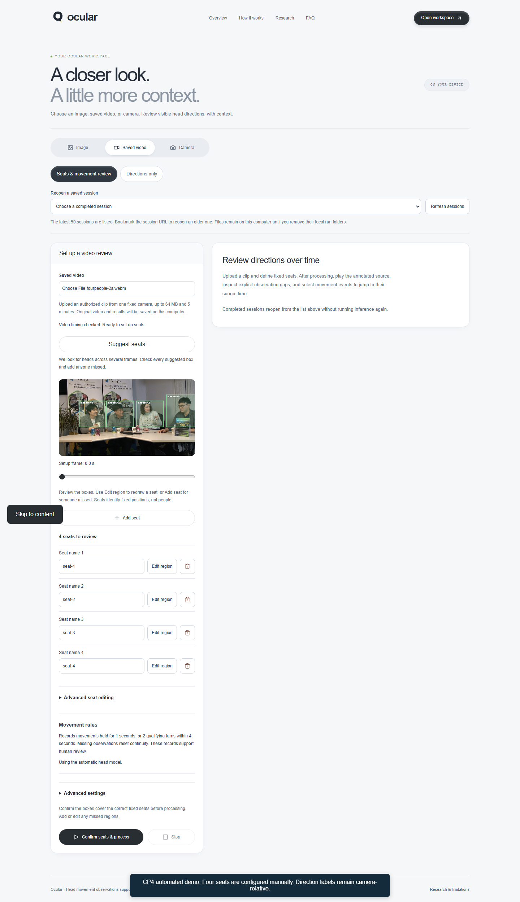
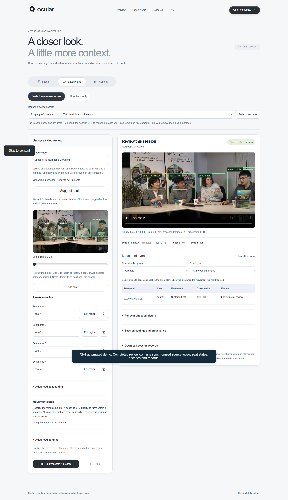

# 2. Interface and visualization of results

**Ocular / GAZE — CP4 draft**  
Prepared: 12 November 2026  
Base source revision: `d60038d3f256f7d2bcc60e6c769018f8c47c2d3c`

**Status:** Implemented interface and historical browser checks are documented; human usability and physical-camera checks remain pending.

The website workspace at /analyze provides Image, Saved video and Camera modes. Saved video offers the automatic direction-only path and a seat-and-movement review path. The faculty workflow presents seat suggestions and manual correction before Confirm seats and process, with numerical coordinates and advanced thresholds collapsed by default. [S02] [S03] [S04] [S17]

| Stage | Visible controls and outputs |
| --- | --- |
| Input and setup | Media preview, method choice, optional mirrored-input setting, fixed seat suggestions, rename/redraw/remove/add controls and plain-language active rules. |
| Processing | Processing state and Stop, shared inference reservation, input validation and clear failures. No fabricated percentage or instantaneous speed claim. |
| Review | Source-time playback, seat regions, detection boxes, direction labels, missing/ambiguous states, filterable movement records and event seeking. |
| Records | Per-seat histories, settings and source hash, observations, events, summaries, compact review JSON, annotated AVI and completed-session reopening. |

## Output meaning

Forward, left, right and down describe visible head orientation. Unknown indicates no usable direction; unassigned indicates that a detection cannot be reliably associated with a configured position. Seat IDs identify places rather than students. Detector scores, where retained, are not calibrated confidence in head direction or misconduct. Boxes, labels and counts satisfy the relevant visualization examples; masks and confidence percentages are not invented. [S01] [S13] [S18]

Historical permitted Pointing04 baseline output. This demonstrates annotation style, not a current Ocular screenshot or CP4 accuracy result. Source: N. Gourier, D. Hall and J. L. Crowley. [S07]

The recorded browser checks cover the integrated workflow and a 390-pixel viewport. They do not replace a human keyboard/usability check on the actual demonstration laptop. Camera review remains an optional separate mode without seat histories, event logging or recordings. [S03] [S04]

## Evidence provenance

Measurements and executions retain their original dates and hardware. This document does not report a new model run, live GitHub task status or academic acceptance. Links refer to the accompanying repository; the source revision above identifies the inspected snapshot.

[S01]: ../../../PRD.md "Product requirements and supported behavior"
[S02]: ../../../ARCHITECTURE.md "Current application architecture and processing paths"
[S03]: ../../../docs/checkpoints/cp4-checklist.md "Phase 4 requirements and outstanding evidence"
[S04]: ../../../docs/superpowers/specs/2026-10-29-saved-review-verification.md "Saved review verification and faculty setup refinement"
[S07]: ../../../docs/evaluation/data-card.md "Pointing04 source permissions and split data card"
[S13]: ../../../docs/evaluation/seats.md "Fixed seat and observation gap semantics"
[S17]: ../../../frontend/README.md "Current website setup and usage"
[S18]: ../../../docs/evaluation/hidden-faces.md "Experimental calibrated head model details"

## Current interface evidence: 12 November 2026

The following screenshots come from the running production application with actual inference, rather than the illustrative landing-page example:

The [browser execution record](../../../outputs/evidence/cp4/browser-verification.json) checks image upload, video timing, four-seat processing, downloads, byte-range access, saved-session reopening and the 390px viewport. The [captioned backup recording](ocular-cp4-demo.webm) shows the actual workflow. A human keyboard/usability check and physical-camera check remain separate; webcam use is optional.
