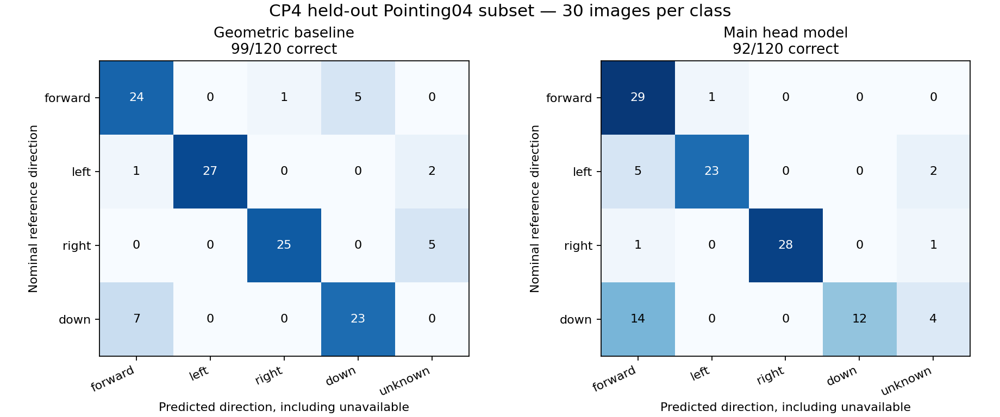

# 3. Held-out evaluation, demo-laptop speed and CP3 comparison

**Ocular / GAZE — measured 12 November 2026.** Task links: [cp4-performance #29](https://github.com/emperuna/gaze-cv/issues/29), [cp4-hand-in #30](https://github.com/emperuna/gaze-cv/issues/30).

## Held-out classification results

The required [src/evaluate.py](../../../src/evaluate.py) produced the [machine-readable result](../../../outputs/evidence/cp4/held-out-results.json) from the [frozen protocol](../../../outputs/evidence/cp4/frozen-protocol.json). The existing Pointing04 selection contains **120 test images**, five subjects (person11–person15), 30 examples per direction. Development uses 240 images from different subjects (person01–person10). Labels and image hashes were unchanged; no thresholds were tuned from the test outcomes.

| Method | Correct / eligible | Accuracy | Macro F1 | Coverage | Unavailable |
| --- | --- | --- | --- | --- | --- |
| Geometric baseline | 99/120 | 82.50% | 0.8519 | 94.17% | 7 |
| Main head model | 92/120 | 76.67% | 0.7807 | 94.17% | 7 |

Accuracy counts every eligible image, including unknown/missed/ambiguous predictions. Macro F1 averages the four fixed classes. Coverage is usable predictions divided by all eligible images. Per-class precision/recall/F1, all per-image predictions and confusion matrices are in the JSON. These are single-person nominal-pose results, not classroom, seat or event accuracy.



## Frozen protocol and reproducible commands

The newer Phase 4 instruction explicitly requests held-out scoring, replacing the earlier CP5-only sequencing for this run. The protocol records the unchanged manifest, model/settings metadata and implementation hashes before any test inference. The evaluator rejects cross-split leakage, changed pixels, settings or code, protected output paths and existing reports. Multiple detections are counted as unknown rather than selecting a convenient face.

After the project-local environment/cache setup in the root README:

```powershell
.\.venv\Scripts\python.exe src/evaluate.py freeze --manifest data/annotations/pointing04.json --output outputs/runs/cp4-protocol.json
.\.venv\Scripts\python.exe src/evaluate.py run --protocol outputs/runs/cp4-protocol.json --output outputs/runs/cp4-held-out.json
```

Use new paths for reproduction. Keep the submitted protocol intact. Its implementation hashes identify the measured code even though the run's Git revision is the pre-commit base and the working tree was dirty. No new freeze should be used to conceal a changed model or input. The test set is now exposed: later development must not treat it as a fresh untouched CP5 set.

## Actual demo-laptop speed

The user confirmed this computer is the classroom demo laptop: **ASUS Vivobook Go E1504FA, AMD Ryzen 5 7520U, four cores/eight threads, approximately 16 GB installed RAM, Windows 11, Python 3.12.10, CPU inference**. The [hardware record](../../../outputs/evidence/cp4/demo-laptop.json) reports Balanced power mode, battery discharging at the recorded capture, and normal desktop apps open. This was a working desktop session rather than an isolated performance lab. Other verification work overlapped part of the measurement session.

Workload: a [permitted two-second FourPeople excerpt](../../../data/samples/cp4/fourpeople-2s.webm), **120 frames, 1280 × 720, 60 source FPS and four fixed seat regions**. Source FPS is the recording's timebase, not processing throughput. Three independent runs per method used the [baseline](../../../configs/cp4-review-baseline.json) and [head](../../../configs/cp4-review-head.json) settings.

| Method | Run 1 FPS | Run 2 FPS | Run 3 FPS | Median FPS |
| --- | --- | --- | --- | --- |
| Baseline, tile grid 2 | 3.32 | 3.77 | 3.44 | 3.44 |
| Head, whole frame | 0.94 | 1.01 | 0.95 | 0.95 |

These full-session rates include timing preflight, decoding, preprocessing, inference, seat/history/event processing, annotation/AVI encoding, JSON exports and final writes. They exclude model initialization, upload/network, browser rendering and manual seat setup. No source frames are removed as warmup in this full-session timer. The reports separately retain the narrower frame-processing timing, which excludes its first five frames and final exports.

Evidence: [baseline benchmark](../../../outputs/evidence/cp4/benchmark-baseline.json), [head benchmark](../../../outputs/evidence/cp4/benchmark-head.json), [benchmark command](../../../scripts/benchmark_review.py).

```powershell
.\.venv\Scripts\python.exe scripts/benchmark_review.py --input data/samples/cp4/fourpeople-2s.webm --settings configs/cp4-review-head.json --output-dir outputs/runs/cp4-speed-head
```

The measured workload does **not reach the 10 FPS target**. The supported fallback is to process a short saved video and review the resulting source-time records afterward. The two-second proxy does not measure sustained five-minute thermal performance or real classroom event correctness.

For the separate image-scoring workload, baseline took 27.88 ms/image and head took 430.05 ms/image. Image timing excludes initialization, checksum preflight and report writing, with no explicit warmup exclusion. It must not be relabeled as video FPS.

## What changed since CP3

| Method | CP3 accuracy | CP4 accuracy | Accuracy difference | F1 difference | Coverage difference |
| --- | --- | --- | --- | --- | --- |
| baseline | 46.03% | 82.50% | +36.47 pp | +0.3644 | +41.79 pp |
| head | 20.63% | 76.67% | +56.03 pp | +0.4737 | +56.07 pp |

**These are arithmetic differences between two different datasets, not measured algorithm improvement.** CP3 used 63 correlated stress images from three Pexels recordings on an Apple M5 MacBook Air; CP4 uses 120 moderate laboratory poses from five held-out Pointing04 subjects on this Windows laptop. No direction algorithm or threshold was changed in this session. CP3's baseline/main image times were 7.66/83.48 ms; hardware and workload changes prevent attributing the timing difference to code efficiency.

Application progress is separate: the browser now connects seat setup, synchronized review, movement records, downloads, cancellation and session reopening. [CP3 record](../cp3-hand-in/README.md), [before/after workflow](../cp4-before-after.md).

## Interpretation and limits

The baseline exceeds the 80% direction target on this specific moderate-pose subset; the main head method does not. Neither result establishes an 80% classroom system accuracy claim. Upstream pretraining overlap cannot be fully audited. Source labels are nominal pose targets. Independent multi-person seat labels, real event intervals and ordinary-writing exposure remain necessary before reporting seat consistency, event precision/recall or writing false-alert rates. See the [data card](../../evaluation/data-card.md) and [limitations](04-performance-and-limitations.md).
