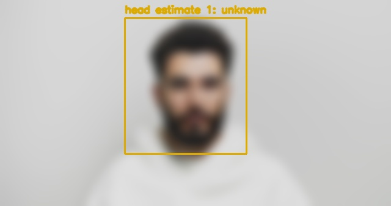
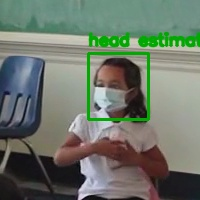

# 4. Performance analysis and limitations

**Ocular / GAZE — CP4 draft**  
Prepared: 12 November 2026  
Base source revision: `d60038d3f256f7d2bcc60e6c769018f8c47c2d3c`

**Status:** Analysis uses recorded failures and operating limits; representative classroom validation remains pending.

The CP3 failure groups provide measured examples of limits. A failed sample is an incorrect or unavailable prediction. The conditions below label the inputs; they are not controlled causal proof. Counts include all 63 samples rather than only the selected gallery. [S09]

| Input condition | Baseline failures | Main failures |
| --- | --- | --- |
| Blur | 9 | 12 |
| Clean pose | 0 | 5 |
| Low light | 6 | 12 |
| Mask and classroom clutter | 2 | 2 |
| Occlusion | 6 | 10 |
| Profile angle | 5 | 0 |
| Small image | 6 | 9 |
| All conditions | 34 | 50 |

Of the main method’s 39 unavailable predictions, 21 had no detection, 13 failed the blur quality gate and five fell outside the supported pose range. These recorded reasons explain why coverage falls; they do not identify every physical cause of a miss. Two masked classroom crops were usable but predicted forward when the reference label was right. [S06] [S09]

## New CP4 held-out error analysis

The [120-image held-out run](../../../outputs/evidence/cp4/held-out-results.json) produced 21 baseline failures and 28 head-model failures, including seven unknowns for each method. The baseline's seven unknowns were mixed down/side observations. The head model recorded four multiple-detection cases, two mixed down/side cases and one missed detection; none was removed from the denominator.

The main model's down recall was 12/30 (40%): 14 downward examples were predicted forward and four were unknown. Its right recall was 28/30 (93.33%). The baseline confused seven down examples with forward and five forward examples with down. These outputs identify the forward/down boundary as an observed weakness; they do not prove a physical cause or justify tuning on this exposed test set.

On these sufficiently visible, moderate laboratory poses, baseline accuracy was 82.50% and head accuracy 76.67%. CP3's blur, dim-light and occlusion stress failures below remain relevant because the CP4 subset is easier and narrower. A larger CP4 score does not erase those limitations.

Integrated four-seat median speed was 3.44 FPS for baseline and 0.95 FPS for head on the demo laptop. This falls below 10 FPS, supporting short saved-video processing followed by review. Source timestamps preserve observed duration even when processing takes longer than the clip. [Full timing scope and conditions](03-evaluation-and-speed.md).

## Examples of observed failures

Recorded CP3 examples: left, forward becomes unknown with head_blurry; right, a reference right label is predicted forward. Pexels sources: cottonbro studio and RDNE Stock project. These examples describe head pose only. [S08] [S09]

The baseline depends on usable facial landmarks and had poor coverage for strong profiles. The learned model handled the six strong portrait profiles well, but lost more samples to detection/quality limits in the overall stress set. Improvements should be developed on distinct development data and checked on a frozen held-out set. [S05] [S08] [S09]

## Operating conditions and remaining limitations

| Area | Supported or demonstrated condition | Limit or unvalidated condition |
| --- | --- | --- |
| Capture layout | One fixed camera and fixed seat regions; manual correction of suggested regions. | Moving cameras, seat changes and unrestricted classroom coverage are outside scope. |
| Input compatibility | Saved review accepts compatible constant-cadence MP4/WebM and checks decoded timestamps. | Unavailable, duplicate, nonfinite or irregular timestamps fail compatibility checks. |
| Resource bounds | Review limits: 64 MB upload, five minutes, 18,000 frames, 1920 by 1080 pixels, 20 seats. | 64 MB compact review JSON and 512 MB output budget; these limits are not throughput guarantees. |
| Observation quality | Clear sufficiently visible heads can produce direction observations; unknown reasons are retained. | Small, blurry, dim, occluded, mixed or unsupported views can be unknown or wrong. |
| Local operation | A local server coordinates upload, review and optional camera processing. | No direct CCTV/RTSP/ONVIF connection, public multi-user service or identity recognition is claimed. |
| Human interpretation | Events organize sustained/repeated movements for an instructor to inspect. | Intent, eye gaze, cheating detection and disciplinary decisions are not inferred. |

## Limits observed during integration

The FourPeople proxy’s 601 frames passed timing inspection with maximum cadence deviation of about 0.333 milliseconds. After correction of a nearby-head padding conflict, suggestions returned five regions for four participants, including an extra small candidate that needed manual removal. This is evidence for faculty confirmation, not perfect seat detection. [S04]

Historical movement diagnostics changed from 12 repeated records to one after adding minimum episode dwell, while observation counts stayed unchanged. The result demonstrates filtering behavior. It does not establish event precision, recall or a reduction in verified writing false alerts. [S11]

Single-person Pointing04 poses and correlated CP3 transformations do not establish performance for distant or crowded classrooms. Independent labels for multi-seat association and real event intervals, ordinary-writing exposure and the target laptop workload remain required. [S03] [S07] [S08]

## Storage and failure behavior

Saved review keeps source media and provenance in local ignored run directories. Cancellation and failed runs do not publish completed-session manifests; partial local outputs can remain for manual cleanup. Source access and retention must be agreed before collecting classroom footage. [S04]

## Evidence provenance

Historical measurements retain their original dates and hardware. New CP4 measurements are dated 12 November 2026 and linked to machine-readable evidence and frozen implementation hashes. The base revision predates the CP4 changes; the hand-in tag identifies the final package. Academic acceptance and live Project status are not claimed.

[S03]: ../../../docs/checkpoints/cp4-checklist.md "Phase 4 requirements and outstanding evidence"
[S04]: ../../../docs/superpowers/specs/2026-10-29-saved-review-verification.md "Saved review verification and faculty setup refinement"
[S05]: ../../../docs/checkpoints/cp3-hand-in/README.md "CP3 hand in index and hardware description"
[S06]: ../../../outputs/evidence/cp3-core/comparison.json "CP3 complete metrics and measurement provenance"
[S07]: ../../../docs/evaluation/data-card.md "Pointing04 source permissions and split data card"
[S08]: ../../../docs/checkpoints/cp3-hand-in/data-card.md "CP3 source permissions labels and stress set data card"
[S09]: ../../../outputs/evidence/cp3-core/README.md "CP3 failure groups and selected output gallery"
[S11]: ../../../docs/evaluation/video.md "Historical video throughput and movement rule diagnostics"
